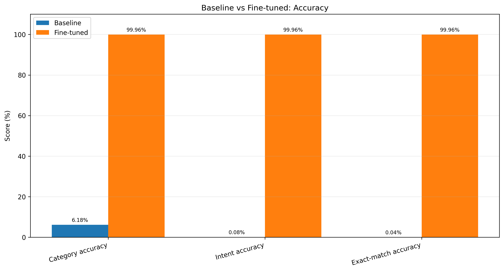
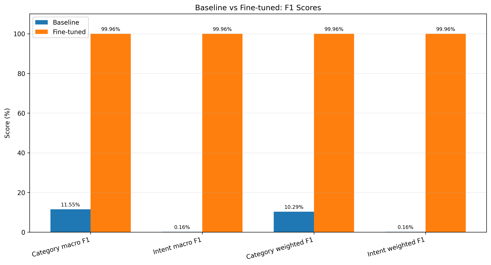
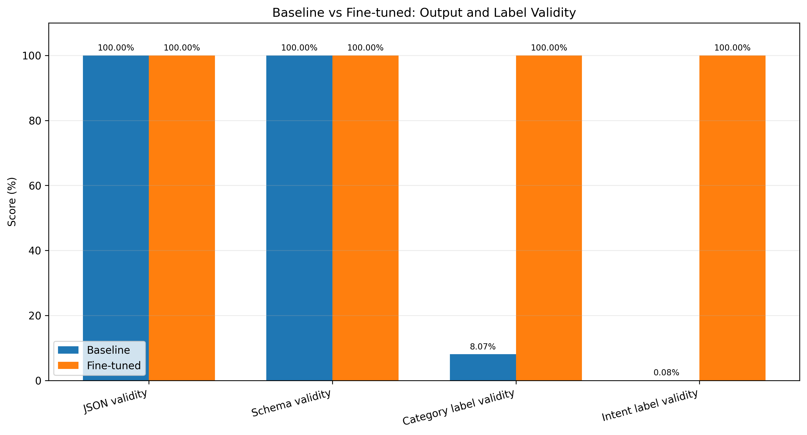

# SupportSFT — Customer Support Classification with QLoRA

<p align="center">
  <strong>Fine-tuning Qwen2.5-0.5B-Instruct for structured customer-support classification</strong>
</p>

<p align="center">
  
  
  
  
</p>

SupportSFT is a parameter-efficient fine-tuning project that adapts **Qwen2.5-0.5B-Instruct** to classify customer-support messages into predefined categories and intents.

The project uses **4-bit quantization and Low-Rank Adaptation (QLoRA)** to fine-tune a small instruction-tuned language model. The objective is to transform an unstructured customer message into a predictable JSON response containing a category and an intent.

The project includes dataset preparation, baseline evaluation, QLoRA fine-tuning, held-out evaluation, classification reports, confusion matrices, and model-comparison visualizations.

> **Main result:** The fine-tuned model achieved **99.9588% category accuracy, 99.9588% intent accuracy, and 99.9588% exact-match accuracy** on the 2,428-example Benchmark A test split. These are results on this benchmark split, not a guarantee of performance on real-world customer conversations.

---

## Table of Contents

- [Project Overview](#project-overview)
- [Problem Statement](#problem-statement)
- [Task and Output Format](#task-and-output-format)
- [Dataset](#dataset)
- [Methodology](#methodology)
- [Model and Training Configuration](#model-and-training-configuration)
- [Training Results](#training-results)
- [Benchmark A: Evaluation Results](#benchmark-a-evaluation-results)
- [Understanding the Metrics](#understanding-the-metrics)
- [Dataset Similarity Audit and Limitations](#dataset-similarity-audit-and-limitations)
- [Project Structure](#project-structure)
- [Notebooks and Scripts](#notebooks-and-scripts)
- [Installation and Environment](#installation-and-environment)
- [Inference Example](#inference-example)
- [Reproducibility and Artifacts](#reproducibility-and-artifacts)
- [Future Improvements](#future-improvements)
- [Dataset and Model Attribution](#dataset-and-model-attribution)
- [License](#license)

---

## Project Overview

Customer-support systems receive messages written in natural language. A support message may describe an account issue, payment problem, delivery question, refund request, or another customer concern.

Automatically identifying the correct category and intent can help downstream systems route requests, prioritize work, and trigger appropriate workflows.

SupportSFT explores this task through supervised fine-tuning of a compact instruction-following language model.

**The model performs two related classification tasks:**

1. **Category classification** — identifies the broad customer-support category.
2. **Intent classification** — identifies the specific intent within the message.

The model is trained to return both predictions in a strict JSON structure.

### Project pipeline

```text
Customer Support Dataset
          |
          v
Data Cleaning and Preparation
          |
          v
Train / Validation / Test Split
          |
          v
Baseline Model Evaluation
          |
          v
QLoRA Fine-Tuning
          |
          v
Fine-Tuned Model Evaluation
          |
          v
Metrics, Classification Reports,
Confusion Matrices and Comparisons
```

## Problem Statement

Given a customer-support message, predict:

- The correct support category.
- The correct intent.
- A machine-readable JSON response containing both labels.

The task is a **multi-output classification problem** implemented using a causal language model.

Instead of adding separate classification heads, the model generates the category and intent as structured text.

## Task and Output Format

### Example input

```text
I want to know how to track my order.
```

### Expected output format

```json
{
  "category": "ORDER",
  "intent": "track_order"
}
```

The example illustrates the output structure; the model's actual predictions depend on the input.

The response is expected to contain:

- A `category` field.
- An `intent` field.
- String values for both fields.
- Valid JSON syntax.

The evaluation pipeline checks JSON validity, the required output structure, label validity, and classification correctness separately.

**Important:** A syntactically valid JSON response is not necessarily a correct classification. The predicted labels must also belong to the valid label vocabularies and match the ground truth.

## Dataset

The project uses the [Bitext Customer Support LLM Chatbot Training Dataset](https://huggingface.co/datasets/bitext/Bitext-customer-support-llm-chatbot-training-dataset).

The dataset contains customer-support messages paired with category and intent annotations.

### Dataset preparation

| Stage | Number of examples |
|---|---:|
| Raw dataset | 26,872 |
| After normalized duplicate removal | 24,274 |
| Training split | 19,419 |
| Validation split | 2,427 |
| Test split | 2,428 |
| **Total after deduplication** | **24,274** |

The data was divided approximately into an 80/10/10 training, validation, and test split.

The model's supervised target consists of the category and intent labels. The dataset's `response` field is **not** used as the model target.

### Dataset considerations

- Normalized duplicate removal is performed before splitting.
- The training and validation splits are used during fine-tuning.
- The test split is reserved for held-out evaluation.
- The test examples and their labels are checked against the prediction files during evaluation.
- The original dataset is not included in this repository.

To reproduce the experiments, obtain the dataset from its original source and follow the preparation steps in the notebooks.

## Methodology

### 1. Baseline evaluation

The base instruction-tuned model is evaluated on the held-out test examples before fine-tuning.

This provides a reference point for measuring how well the original model follows the required category and intent label vocabulary.

The baseline evaluation checks:

- JSON syntax validity.
- Required JSON structure.
- Category label validity.
- Intent label validity.
- Category accuracy.
- Intent accuracy.
- Exact-match accuracy.
- Precision, recall, and F1-score.

Invalid or unknown labels are retained as explicit invalid predictions during evaluation rather than silently discarded.

### 2. QLoRA fine-tuning

The base model is fine-tuned using **Quantized Low-Rank Adaptation (QLoRA)**.

QLoRA combines low-bit quantization of the pretrained model with trainable low-rank adapter weights. This reduces the memory required for fine-tuning while allowing selected model parameters to adapt to the target task.

The base model is loaded in 4-bit NF4 format, while LoRA adapters are trained on selected attention and feed-forward projection modules.

### 3. Fine-tuned evaluation

The fine-tuned model is evaluated on the same held-out Benchmark A test split used for baseline evaluation.

The evaluation pipeline compares predictions against the ground-truth labels and generates:

- Aggregate evaluation metrics.
- Category and intent classification reports.
- Category and intent confusion matrices.
- Model-comparison tables and visualizations.
- Prediction-level error analysis.

The evaluation scripts also verify that prediction rows correspond to the expected test examples and preserve their ordering.

---

## Model and Training Configuration

### Base model

| Parameter | Value |
|---|---|
| Model | `Qwen/Qwen2.5-0.5B-Instruct` |
| Fine-tuning method | QLoRA |
| Quantization | 4-bit NF4 |
| Double quantization | Enabled |
| Compute dtype | FP16 |
| Adapter method | LoRA |
| PEFT version | 0.21.2 |

### LoRA configuration

| Parameter | Value |
|---|---:|
| Rank (`r`) | 16 |
| LoRA alpha | 32 |
| LoRA dropout | 0.05 |
| Trainable parameters | 8,798,208 |
| Approximate trainable share | 1.75% |

**Target modules:**

```text
q_proj
k_proj
v_proj
o_proj
gate_proj
up_proj
down_proj
```

### Training configuration

| Parameter | Value |
|---|---:|
| Maximum sequence length | 96 |
| Per-device batch size | 8 |
| Gradient accumulation steps | 2 |
| Effective batch size | 16 |
| Learning rate | 2e-4 |
| Weight decay | 0.01 |
| Warmup ratio | 0.03 |
| Maximum gradient norm | 1.0 |
| Training epochs | 3 |

### Training environment

| Component | Environment |
|---|---|
| Development platform | Windows 11 Pro, 64-bit |
| Local Python | 3.10.11 |
| Training platform | Google Colab |
| Training Python | 3.13.16 |
| PyTorch in Colab | 2.11.0+cu130 |
| GPU | NVIDIA Tesla T4 |
| GPU memory | Approximately 15.64 GB |

---

## Training Results

The training run recorded the following losses:

| Epoch | Global step | Training loss | Validation loss |
|---:|---:|---:|---:|
| 1 | 1,314 | 0.0030103 | 0.0004711 |
| 2 | 2,528 | 0.0003317 | **0.0004628** |
| 3 | 3,742 | 0.0000807 | 0.0005732 |

The lowest recorded validation loss was at **Epoch 2**, and that checkpoint was selected as the best adapter.

> **Training-history note:** The notebook's continuation/resume workflow included 100 prior optimizer updates. The recorded global steps therefore reflect the continued training state; this should not be interpreted as a completely fresh run starting from global step zero.

Training loss and validation loss are language-model token prediction losses. They are not category accuracy, intent accuracy, or classification F1 scores.

---

## Benchmark A: Evaluation Results

The following results were obtained on the held-out test split containing **2,428 examples**.

### Overall comparison

| Metric | Baseline | Fine-tuned |
|---|---:|---:|
| JSON validity | 100.0000% | 100.0000% |
| Category label validity | 8.0725% | 100.0000% |
| Intent label validity | 0.0824% | 100.0000% |
| Category accuracy | 6.1779% | **99.9588%** |
| Intent accuracy | 0.0824% | **99.9588%** |
| Exact-match accuracy | 0.0412% | **99.9588%** |
| Category macro F1 | 11.5452% | **99.9573%** |
| Category weighted F1 | 10.2889% | **99.9588%** |
| Intent macro F1 | 0.1623% | **99.9576%** |
| Intent weighted F1 | 0.1629% | **99.9588%** |

The fine-tuned model produced valid JSON and valid category and intent labels for all 2,428 test examples. It classified 2,427 examples correctly on both outputs.

### Accuracy comparison



### F1-score comparison



### Output and label validity comparison



### Classification report details

The fine-tuned model's detailed classification reports include the following aggregate scores:

| Task | Average | Precision | Recall | F1-score |
|---|---|---:|---:|---:|
| Category | Macro | 99.9703% | 99.9446% | 99.9573% |
| Category | Weighted | 99.9589% | 99.9588% | 99.9588% |
| Intent | Macro | 99.9531% | 99.9626% | 99.9576% |
| Intent | Weighted | 99.9593% | 99.9588% | 99.9588% |

### Confusion matrices

The evaluation pipeline generates separate category and intent confusion matrices for both models.

Each confusion matrix includes the valid labels and an additional unknown-label class, so invalid predictions remain represented in the evaluation.

Files:

- Baseline category: `reports/benchmark_a/baseline_confusion_matrices/category_confusion_matrix.png`
- Baseline intent: `reports/benchmark_a/baseline_confusion_matrices/intent_confusion_matrix.png`
- Fine-tuned category: `reports/benchmark_a/fine_tuned_confusion_matrices/category_confusion_matrix.png`
- Fine-tuned intent: `reports/benchmark_a/fine_tuned_confusion_matrices/intent_confusion_matrix.png`

---

## Understanding the Metrics

The evaluation separates output formatting from actual classification performance.

| Metric | Meaning |
|---|---|
| JSON validity | Whether the generated output can be parsed as JSON |
| Schema validity | Whether the output contains the required `category` and `intent` fields with non-empty string values |
| Category label validity | Whether the predicted category belongs to the known category vocabulary |
| Intent label validity | Whether the predicted intent belongs to the known intent vocabulary |
| Accuracy | Fraction of examples with the correct prediction for the evaluated task |
| Precision | Fraction of predicted instances of a class that are correct |
| Recall | Fraction of actual instances of a class that are correctly identified |
| Macro F1 | Unweighted average of per-class F1 scores |
| Weighted F1 | Average of per-class F1 scores weighted by class support |
| Exact-match accuracy | Fraction of examples where both category and intent are correct |

### Exact-match accuracy

An example is counted as an exact match only when **both** its predicted category and predicted intent match the ground-truth labels.

\[
\text{Exact Match Accuracy}
=
\frac{
\sum_{i=1}^{N}
\mathbf{1}
[
\hat{c}_i=c_i
\land
\hat{t}_i=t_i
]
}{N}
\times 100
\]

Where:

- \(N\) is the number of test examples.
- \(c_i\) is the actual category.
- \(\hat{c}_i\) is the predicted category.
- \(t_i\) is the actual intent.
- \(\hat{t}_i\) is the predicted intent.
- \(\mathbf{1}[\cdot]\) equals 1 when both conditions are true, otherwise 0.

For this benchmark, 2,427 out of 2,428 examples were exact matches.

### Why JSON validity is not enough

The baseline model achieved 100% JSON validity but performed poorly on category and intent label validity.

This demonstrates an important distinction: a language model can generate syntactically valid structured output while still predicting labels that do not belong to the task's defined vocabulary.

The evaluation therefore measures formatting, label validity, and classification correctness independently.

---

## Dataset Similarity Audit and Limitations

A character n-gram TF-IDF similarity audit was performed to examine how similar test examples were to their nearest training examples.

### Similarity audit results

| Statistic | Similarity |
|---|---:|
| Mean | 0.8856 |
| Median | 0.9005 |
| 90th percentile | 0.9792 |
| 95th percentile | 0.9864 |
| 99th percentile | 0.9991 |
| Test examples with similarity ≥ 0.80 | 85.05% |
| Test examples with similarity ≥ 0.90 | 50.21% |
| Test examples with similarity ≥ 0.95 | 24.59% |
| Test examples with similarity ≥ 0.99 | 3.58% |

Nearest-training-example label agreement:

| Label type | Agreement |
|---|---:|
| Category | 99.92% |
| Intent | 98.35% |

These results indicate substantial lexical similarity between many test examples and their nearest training examples.

**High similarity does not prove data leakage.** However, it does mean that the benchmark's near-perfect classification results should be interpreted cautiously. The model may benefit from recurring wording patterns and label associations in this dataset.

### Observed fine-tuned error

The fine-tuned model made one classification error on the 2,428-example Benchmark A test split.

| Field | Value |
|---|---|
| Input | `I'm trying to find shpping period help me` |
| Actual category | `DELIVERY` |
| Actual intent | `DELIVERY_PERIOD` |
| Predicted category | `ORDER` |
| Predicted intent | `TRACK_ORDER` |

The output was valid JSON and contained valid labels, but the predicted classification was incorrect.

This example illustrates why structured-output validity and classification correctness must be evaluated separately.

### Limitations

- The benchmark is based on one customer-support dataset.
- High lexical similarity between train and test examples limits claims about generalization to substantially different customer language.
- The evaluation does not establish performance on live customer-support traffic.
- The benchmark does not cover every possible category, intent, spelling variation, or domain-specific request.
- The reported results should not be interpreted as production-level reliability without further testing.

A separate, more challenging evaluation set containing less similar examples and more varied customer language would provide stronger evidence of generalization.

---

## Project Structure

The following tree describes the main project files and report artifacts used in the project. Dataset files, model weights, prediction-level CSVs, and other local-only artifacts are intentionally excluded from the public repository.

```text
SupportSFT/
│
├── notebooks/
│   ├── 01_baseline_model_evaluation.ipynb
│   └── 02_qlora_training_and_finetuned_evaluation.ipynb
│
├── scripts/
│   ├── audit_language_tags.py
│   ├── audit_split_similarity.py
│   ├── audit_tag_label_coverage.py
│   ├── create_model_comparison.py
│   ├── evaluate_baseline.py
│   └── evaluate_finetuned.py
│
├── src/
│   └── supportsft/
│       ├── data.py
│       ├── evaluation.py
│       └── prompts.py
│
├── reports/
│   ├── benchmark_a/
│   │   ├── accuracy_comparison.png
│   │   ├── f1_comparison.png
│   │   ├── validity_comparison.png
│   │   ├── baseline_metrics.json
│   │   ├── fine_tuned_metrics.json
│   │   ├── model_comparison.csv
│   │   ├── model_comparison.json
│   │   ├── comparison_summary.md
│   │   ├── baseline_classification_reports.json
│   │   ├── fine_tuned_classification_reports.json
│   │   ├── baseline_confusion_matrices/
│   │   └── fine_tuned_confusion_matrices/
│   │
│   └── dataset_audit/
│       ├── language_tag_audit.csv
│       ├── tag_category_coverage.csv
│       └── tag_coverage_summary.csv
│
├── artifacts/
│   └── training/
│       └── training_history.json
│
├── .gitignore
├── LICENSE
└── README.md
```

`pyproject.toml` and any additional root-level configuration files should be retained in the repository if present. The tree above focuses on the project files and reports confirmed in the shared project history; it is not intended to imply that every possible local file is published.

## Notebooks and Scripts

### Notebooks

| Notebook | Purpose |
|---|---|
| `01_baseline_model_evaluation.ipynb` | Baseline model evaluation and generation of baseline predictions |
| `02_qlora_training_and_finetuned_evaluation.ipynb` | QLoRA fine-tuning, training-history tracking, and fine-tuned model evaluation |

### Source modules

| File | Responsibility |
|---|---|
| `src/supportsft/data.py` | Dataset preparation and data-related utilities |
| `src/supportsft/evaluation.py` | Prediction parsing, output validation, metric calculation, and classification reports |
| `src/supportsft/prompts.py` | Prompt and structured-output definitions |

### Scripts

| Script | Responsibility |
|---|---|
| `scripts/evaluate_baseline.py` | Evaluates baseline predictions and generates evaluation reports |
| `scripts/evaluate_finetuned.py` | Evaluates fine-tuned predictions and generates evaluation reports |
| `scripts/create_model_comparison.py` | Produces aggregate model-comparison outputs and visualizations |
| `scripts/audit_language_tags.py` | Audits language-tag information in the dataset |
| `scripts/audit_split_similarity.py` | Examines train/test text similarity |
| `scripts/audit_tag_label_coverage.py` | Examines tag and label coverage |

---

## Installation and Environment

The project was developed using Python 3.10.11 locally and Google Colab for GPU-based fine-tuning.

### 1. Clone the repository

```bash
git clone https://github.com/Ramu1904/SupportSFT.git
cd SupportSFT
```

### 2. Create a virtual environment

```bash
python -m venv .venv
```

Activate it on Windows PowerShell:

```powershell
.\.venv\Scripts\Activate.ps1
```

### 3. Install dependencies

The project workflow installs and configures dependencies through the notebook setup cells. There is no separately documented, pinned `requirements.txt` installation workflow in this README.

For the most accurate environment setup, follow the dependency installation cells in the notebooks, particularly the QLoRA training notebook. GPU-specific PyTorch and quantization dependencies should be installed in the training environment supported by the relevant packages.

**Note:** The local development environment and Colab training environment used different Python versions. The Colab training environment used Python 3.13.16 and PyTorch 2.11.0+cu130; the local environment used Python 3.10.11.

### 4. Dataset setup

Download the dataset from the original [Bitext dataset page](https://huggingface.co/datasets/bitext/Bitext-customer-support-llm-chatbot-training-dataset) and follow the data preparation workflow in the notebooks.

The dataset and processed CSV files are not committed to this repository.

---

## Inference Example

The fine-tuned model is designed to generate a JSON object containing a category and intent.

The following is an illustrative inference pattern for loading a base model with a locally saved PEFT adapter. It is not a claim that this exact standalone snippet has been independently tested as a packaged inference interface.

```python
import torch
from transformers import AutoModelForCausalLM, AutoTokenizer
from peft import PeftModel

BASE_MODEL = "Qwen/Qwen2.5-0.5B-Instruct"
ADAPTER_PATH = "PATH_TO_LOCAL_ADAPTER"

tokenizer = AutoTokenizer.from_pretrained(BASE_MODEL)

base_model = AutoModelForCausalLM.from_pretrained(
    BASE_MODEL,
    torch_dtype=torch.float16,
    device_map="auto",
)

model = PeftModel.from_pretrained(
    base_model,
    ADAPTER_PATH,
)

model.eval()

messages = [
    {
        "role": "user",
        "content": (
            "Classify this customer-support message: "
            "I want to know how to track my order."
        ),
    }
]

prompt = tokenizer.apply_chat_template(
    messages,
    tokenize=False,
    add_generation_prompt=True,
)

inputs = tokenizer(
    prompt,
    return_tensors="pt",
).to(model.device)

with torch.no_grad():
    outputs = model.generate(
        **inputs,
        max_new_tokens=64,
        do_sample=False,
    )

generated_tokens = outputs[0][inputs["input_ids"].shape[-1]:]

response = tokenizer.decode(
    generated_tokens,
    skip_special_tokens=True,
)

print(response)
```

Replace `PATH_TO_LOCAL_ADAPTER` with the actual local adapter directory. The adapter weights are not included in the public Git repository, and a public Hugging Face adapter link is not provided here.

The returned text should still be parsed and validated before it is used by a downstream application.

---

## Reproducibility and Artifacts

The repository includes selected source code, notebooks, training history, and aggregate evaluation reports.

Some experiment artifacts are intentionally kept locally rather than committed.

### Included in the repository

- Source modules and evaluation scripts.
- Baseline and fine-tuning notebooks.
- Aggregate Benchmark A metrics.
- Classification reports.
- Confusion-matrix visualizations and their report files.
- Model-comparison outputs.
- Selected dataset-audit summaries.
- Training history JSON.
- MIT license.

### Kept locally

- Original and processed dataset CSV files.
- Model weights and adapter checkpoints.
- Intermediate training checkpoints.
- Row-level baseline prediction CSVs.
- Row-level fine-tuned prediction CSVs.
- Prepared prediction CSVs.
- Detailed error-analysis CSVs excluded by `.gitignore`.
- Local-only experiments and Benchmark B artifacts.

This separation keeps the public repository focused on code, methodology, and aggregate results while avoiding large model files and data-heavy intermediate artifacts.

---

## Future Improvements

Potential next steps for strengthening the project include:

- Evaluate on a more challenging test set with lower train/test lexical similarity.
- Test robustness to spelling mistakes, informal language, and paraphrased requests.
- Evaluate on additional customer-support datasets.
- Measure inference latency and memory usage.
- Compare QLoRA with other parameter-efficient fine-tuning configurations.
- Add a reusable inference interface with explicit JSON parsing and validation.
- Investigate confidence estimation and handling of out-of-vocabulary intents.
- Evaluate performance on real-world customer-support messages before considering production use.

These are possible extensions, not claims about features already implemented.

---

## Dataset and Model Attribution

This project uses third-party resources:

- **Dataset:** [Bitext Customer Support LLM Chatbot Training Dataset](https://huggingface.co/datasets/bitext/Bitext-customer-support-llm-chatbot-training-dataset)
- **Base model:** [Qwen2.5-0.5B-Instruct](https://huggingface.co/Qwen/Qwen2.5-0.5B-Instruct)
- **Fine-tuning approach:** [PEFT documentation](https://huggingface.co/docs/peft/index)
- **Training approach:** QLoRA, using 4-bit quantization and LoRA adapters.

Please refer to the original dataset and model repositories for their respective licenses, terms, and attribution requirements.

## License

This project is licensed under the MIT License. See [LICENSE](LICENSE) for details.

The MIT license for this repository does not replace or override the licenses of the third-party dataset or pretrained model used in the project.